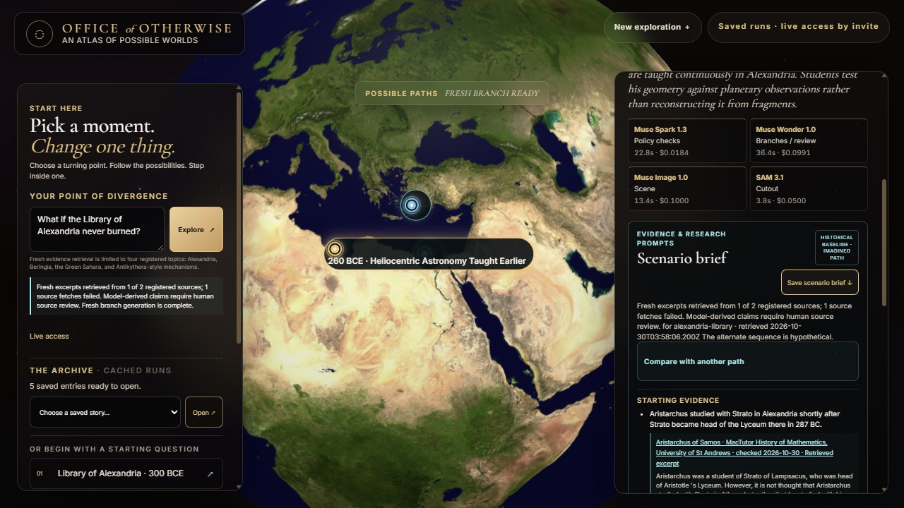
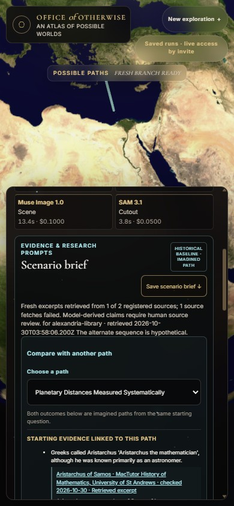

# Fresh-evidence UI screenshots

These screenshots show the actual final fresh run, `1793332668066`, in the evidence and comparison views.

| Viewport | Screenshot | Review |
| --- | --- | --- |
| Desktop, 1280 × 720 | [desktop.jpg](desktop.jpg) | Fresh evidence status and linked excerpt are visible; the comparison entry point is shown. |
| Mobile, 390 × 844 | [mobile.jpg](mobile.jpg) | Expanded comparison selector and source-linked baseline remain within the viewport; no horizontal overflow or client error was observed. |

The UI surfaces the partial retrieval: one of two registered Alexandria sources timed out, while the MacTutor excerpt was available. The capture was taken from run `1793332668066`; it is a local UI artifact and does not represent independent factual validation, user feedback, upload, or submission.

